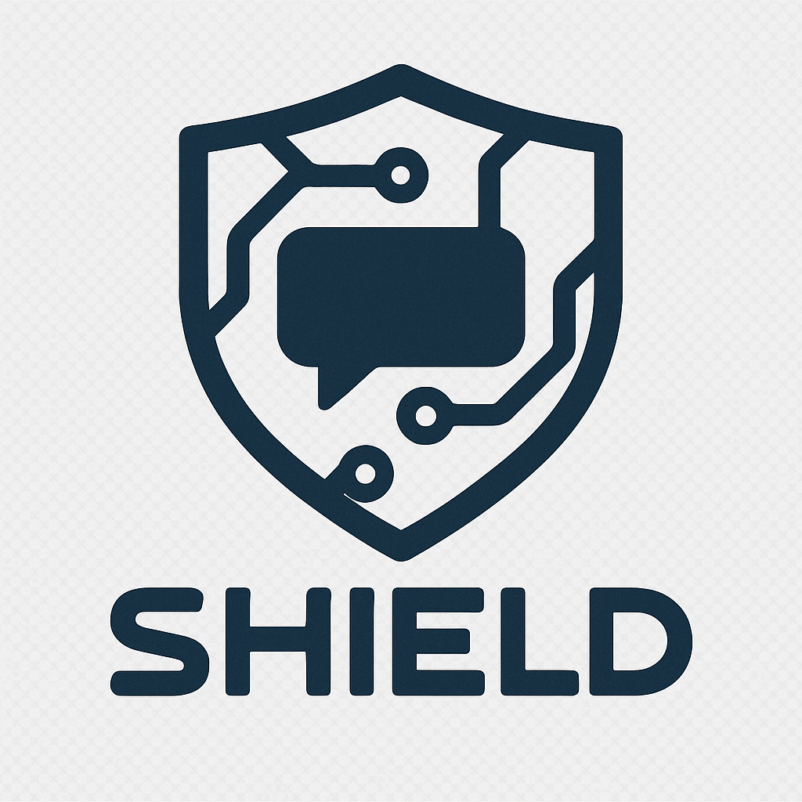
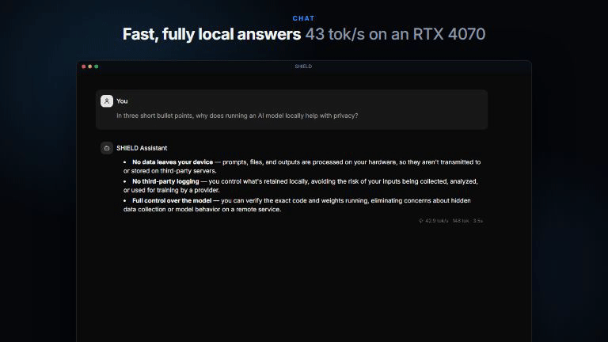

<div align="center">



# SHIELD 2.0

**A private AI agent for your desktop. It runs local models on your own GPU, works in your files and terminal with your permission, and keeps your data on your machine.**

[](https://github.com/BuQQzz/SHIELD2.0/releases/latest)
[](https://github.com/BuQQzz/SHIELD2.0/releases)
[](LICENSE)


### [⬇️ Download SHIELD for Windows or Linux](https://github.com/BuQQzz/SHIELD2.0/releases/latest)

Windows installer or portable `.exe`, or a Linux AppImage. No account and no sign-up.

<a href="https://github.com/BuQQzz/SHIELD2.0/releases/download/v0.2.0/shield-demo.mp4">
  
</a>

**[▶️ Watch the full 45-second demo](https://github.com/BuQQzz/SHIELD2.0/releases/download/v0.2.0/shield-demo.mp4)**: runtime install, the Model Library, chat, a Code session and the privacy controls. Recorded on the v0.2.0 build with Bonsai 2 27B on an RTX 4070.

</div>

---

## What SHIELD is

SHIELD started as a local chatbot. It is now an **agent harness**, built to be as capable as hosted coding agents but **offline-first**: the model, your chats, its memory and your files all stay on your PC unless you choose a hosted model.

- 💬 **Chat** with local GGUF models, with live token counts and collapsible reasoning.
- 🛠️ **Code** in a project folder. SHIELD reads, edits and writes files, runs terminal commands and searches the web, and asks you first when a step can change something.
- 👥 **Teams** let an orchestrator delegate parts of a task to sub-agents, for example a coder and a reviewer.
- 🧠 **Memory, recall and projects**: SHIELD remembers you and each project from one session to the next, brings back what matters from past chats, and a project remembers its folder and its `AGENTS.md` instructions.
- 🔌 **Connectors** link SHIELD to Notion, Linear, GitHub and other services with one click, or to any MCP server you add.

## What makes SHIELD different

- **👥 Teams on one GPU.** An orchestrator splits a task across sub-agents, such as a coder and a reviewer, and they take turns on the same local model. Agents report back with a short handoff, and one that runs out of room hands over so the next carries on instead of starting over. Team agents use native tool calls too.
- **🧠 Recall.** Before each message, SHIELD searches its memory of your other conversations (full-text, no extra model, nothing leaves your PC) and passes the one or two best matches along. A match from a session whose record shows changes that were never made says so, so an old "fix" that failed doesn't come back as a fact.
- **🗂️ Memory that checks itself.** SHIELD keeps short notes about you and each project, and every new session starts with them. It saves what you say about yourself (with an Undo), what you ask it to remember, and the lasting facts from long sessions. A note that names a missing file, or that a later session found had changed, gets a one-line "still true?" check, and only you remove notes. Everything stays on your PC; see and edit it in **Settings › Memory**.
- **📒 A record of what really happened.** SHIELD keeps its own log of what each session changed and ran, separately from what the model says it did. Recall, summaries and handoffs build on that record.
- **🛡️ Safety that explains itself.** Permission prompts say when a call leaves your project or is risky, and a red warning appears before a real folder is deleted. Tool results are treated as untrusted data. SHIELD checks its work with throwaway data rather than your files, and opens pages it built to catch their errors.
- **⚡ Big models on small GPUs.** Bonsai 2 27B runs with a 32K context, fully on an 8 GB card.

## Features

### ⚡ Local inference on the Prism / llama.cpp engine

- **One engine:** every local model runs on `llama-server` (PrismML's llama.cpp build), managed by SHIELD.
- **One-click runtime install:** in **Settings › Runtime**, SHIELD picks the right build for your hardware (CUDA 13, CUDA 12.4, Vulkan or CPU), checks its SHA-256, test-runs it before switching over, and keeps the previous build so you can roll back.
- **GPU-aware loading:** context size and layer placement are planned from your VRAM. Models that need it get a fixed all-on-GPU placement, and speculative drafting (ngram) is always on.
- **Model Library:** browse, download and manage GGUF models, including gated Hugging Face models with your own token.
- **Native tool calls:** on models that support them, llama-server limits each tool call to the tool's JSON schema, so the model can't write a malformed call. The model gets its own thinking back within a request, so a multi-step task keeps its train of thought.

### 🔌 Connectors (new in 0.3)

- **One click:** on the **Plugins** page, press **Connect** and sign in in your browser. Listed services are Notion, Linear, Jira & Confluence, Asana, Sentry, Zapier, Hugging Face and Context7. GitHub connects with a token. SHIELD registers itself with each service, so there's nothing to set up.
- **Your own servers:** add any MCP server by its address (with a token, or a browser sign-in if it asks), or by a command SHIELD starts on your PC.
- **Native tools:** a connector's tools reach the model as native calls (`notion__search`), in chats and Code sessions, and still go through your permission mode.
- **You stay in control:** switch any tool off, and see how much of the context window each service's tools take up.
- **Encrypted sign-ins:** tokens and sign-ins are encrypted with the system key store and never written in plain text. Read-only claims are trusted only from listed services.

### 🤖 Agent harness and tools

- **MCP tools:** built-in filesystem tools (read, write, edit, list, search) through the Model Context Protocol, plus [connectors](#-connectors-new-in-03).
- **SHIELD's own tools:** `run_command` (PowerShell / shell), web search and page fetch, deletion through the Recycle Bin or Trash, and memory search.
- **Plan mode:** the model describes the steps without running anything that changes your files.
- **Reliable long tasks:** a progress check instead of a fixed round limit, a repetition and thinking-loop guard, and a **stuck bar** (Nudge, Skip step, Restart and retry) when a step stalls.
- **Long sessions that stay on track:** big code files are read as an outline plus the part needed, stale reads are cleared first when the window fills, and summaries keep your requests, offered ideas and project facts. Clearing and summarising are arranged so the server reuses its cache, which avoids slow full re-reads.
- **Edit safety:** an `edit_file` that would match more than one place is sent back to the model unrun, and a failed edit shows the model the file's closest lines.
- **Tolerant parsing:** XML, OpenAI, Qwen and DeepSeek DSML call formats are all read as SHIELD tool calls.
- **Model-switch handoff:** switching models mid-chat offers a new session that starts from a short briefing the old model writes.

### 🔐 Permissions, security and privacy

| Mode          | What the agent may do                                                              |
| ------------- | ---------------------------------------------------------------------------------- |
| **Ask**       | Approve each tool call, or allow one tool for the session                          |
| **Auto**      | Reads run on their own. Deleting, and any command that isn't read-only, still asks |
| **Plan**      | Describe the steps, run nothing                                                    |
| **Read only** | Tools that can change files are hidden from the model                              |

- Unknown tools fail closed.
- **Tool results are untrusted data:** file contents, web pages and command output are wrapped in a `trusted="false"` envelope so that instructions planted inside them are not obeyed (see [Research](#-research-and-experimental-work)).
- **Prompts that explain:** a permission prompt says when a call leaves the project, needs admin rights, or deletes a folder that isn't throwaway, and a denied call tells the model which warning you saw.
- **API keys** for hosted providers and **connector sign-ins** are encrypted with the operating system's credential store (Electron `safeStorage`) and never reach the app window.
- **No telemetry.** Model lists are fetched only when you open the picker, never at startup. Message text isn't logged for hosted models.

### ☁️ Optional hosted models, privacy first

Bring your own API key in **Settings › Providers** to run the same harness on a hosted model:

- **Experiential Labs** preset, with **zero data retention required by default.** Every request asks for it, and any reply the gateway doesn't confirm as zero-retention is thrown away. This preset gives access to models such as **DeepSeek V4.1**, whose native call markup SHIELD reads.
- **Any OpenAI-compatible API** through the custom preset.
- A badge under each hosted reply shows who served it and whether that route kept your data. A model with no zero-retention route can be allowed on its own, and its replies are marked **"keeps data"**.

## Working vs experimental

| ✅ Working (used in real sessions)                      | 🧪 Experimental / in progress                                     |
| ------------------------------------------------------- | ----------------------------------------------------------------- |
| Local chat and Code sessions on llama-server            | Team mode on hosted models (untested)                             |
| File tools, terminal, web search, permission modes      | Native function calling for hosted models                         |
| Runtime installer (Vulkan build tested end to end)      | Re-reading what a summary replaced                                |
| Hosted models through Experiential with zero retention  | Policy: always ask before a change that follows an untrusted read |
| Recall, memory, projects, `AGENTS.md`, Plan mode        | Sign-in services (Notion, Linear, ...): tested up to the browser  |
| Memory notes and the memory check (new in 0.4)          |                                                                   |
| Native tool calls on Bonsai 2 27B, team agents included | Linux AppImage (new in 0.3; the app itself is developed on Linux) |
| Connectors: Context7 and your own MCP servers           | Grammar-constrained calls for more model families                 |

## Tested models

Measured on consumer GPUs (RTX 2070 SUPER 8 GB, RTX 4070 12 GB):

| Model                   | Notes                                                                                             |
| ----------------------- | ------------------------------------------------------------------------------------------------- |
| **Bonsai 2 27B** PTQ1_0 | Default. Fully on GPU with a 32K context on 8 GB, ~36-42 tok/s, best tool-call reliability so far |
| Qwen3.8 27B IQ1_M       | Fits on 8 GB with a shorter window; marked with a caution label                                   |
| LFM3 1.7B               | A small, fast chat model                                                                          |
| Gemma 4 12B Q4_K_M      | ~42 tok/s on 12 GB, 8/8 on the GPU smoke test                                                     |
| Qwen3-Coder 30B         | Works, spills into system RAM on 12 GB                                                            |

## 🧪 Research and experimental work

SHIELD is also a test bed for **agent security on small local models**:

- **Prompt injection through tool results:** a planted "create pwned.txt" instruction inside a file the model was asked to summarise was obeyed **3/3** times on the text-call path (Qwen2.5-7B) and **1/3** with native calling. That finding led to the untrusted-data envelope. The next step being designed is a policy that asks before any change that follows a read of untrusted content.
- **SHIELD Agent Benchmark:** repeatable multi-model runs that measure tool-call failures, rounds, speed and whether the file really changed. See [docs/testing/AGENT_BENCHMARK.md](docs/testing/AGENT_BENCHMARK.md).
- **Architecture notes:** permission and trust model, context engine, tool calling and the decision log are in [docs/SHIELD_AGENT_ARCHITECTURE.md](docs/SHIELD_AGENT_ARCHITECTURE.md).

## Getting started

### Install

1. From the [latest release](https://github.com/BuQQzz/SHIELD2.0/releases/latest), download:
   - **Windows:** `SHIELD-<version>-x64.exe` (installer) or `SHIELD-<version>-portable.exe`
   - **Linux:** `SHIELD-<version>-x86_64.AppImage`, then make it executable (`chmod +x SHIELD-*.AppImage`) and run it
2. Open **Settings › Runtime** and install the llama.cpp runtime (one click).
3. Open the **Library**, download a model, and start a chat.
4. Optional: open **Plugins** to connect your services.

**Recommended:** Windows 10/11 or a recent 64-bit Linux, 16 GB+ RAM, and an NVIDIA GPU with 8 GB+ VRAM (12 GB is comfortable). Vulkan and CPU builds also work, but more slowly.

> **Windows SmartScreen:** SHIELD isn't code-signed yet, so Windows may say it "couldn't verify" the file. Click **More info → Run anyway**. The source is all here if you want to check it or build it yourself.

### Build from source

```powershell
git clone https://github.com/BuQQzz/SHIELD2.0.git
cd SHIELD2.0
npx npm@11 install
npm run dev:electron          # run the app
npx vitest run                # tests
npm run build:win             # Windows installer + portable in release/<version>/
npm run build:linux           # Linux AppImage in release/<version>/
```

## Tech stack

Electron 40 · React 19 · TypeScript · Vite 7 · Tailwind CSS 4 · shadcn/ui · llama.cpp (`llama-server`, PrismML build) · Model Context Protocol SDK · Zustand · Vitest

## Documentation

- [Changelog](CHANGELOG.md)
- [Agent architecture](docs/SHIELD_AGENT_ARCHITECTURE.md)
- [Agent benchmark](docs/testing/AGENT_BENCHMARK.md)
- [Windows build](docs/WINDOWS_BUILD.md)
- [MCP integration](docs/mcp-integration.md)
- [Docs index](docs/README.md)

---

<div align="center">

MIT licensed · Built by [BuQQzz](https://github.com/BuQQzz) · Privacy first

</div>
